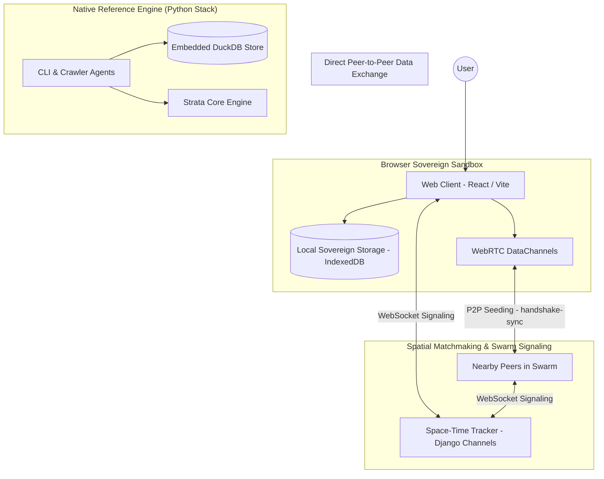

# Handshake: Space-Time Connections

## The Vision
**Handshake** is a decentralized, space-time anchored communication network where the central focus is **the message, not user profiles or accounts**. 

Rather than managing abstract digital identities or infinite algorithm-driven feeds, Handshake proposes a landscape of **digital graffitis anchored in exact coordinates and time**. Location is never passive surveillance or tracking imposed on the user; it is an **expressive, voluntary, and strictly necessary act**—in Handshake, no message can exist without its space-time anchor. The virtual network's core unit of value and memory is the space-time trace itself—seeded, preserved, and explored collectively through peer-to-peer swarms. While physical proximity or in-person exchanges exist as optional local capabilities, messages live, circulate, and retain value on their own merit across space and time.

## Architectural Pillars
Handshake is founded on five inviolable architectural invariants (detailed in [Architectural Invariants](docs/architecture-invariants.md)):

1. **Cryptographic Identity:** Sovereign asymmetric keypairs without centralized user accounts; deterministic canonical serialization (RFC 8785) ensures tamper-proof message authenticity.
2. **Space-Time Anchoring:** Messages exist strictly at voluntary, expressive coordinates (latitude, longitude, derived geohash cell, and timestamp) for both root messages and conversation replies.
3. **Decentralized Network Topology:** Distribution is strictly peer-to-peer; the Space-Time Tracker serves as an ephemeral matchmaking coordinator with no centralized persistence of messages or accounts.
4. **Sovereign Storage & Emergent Persistence:** Local-first storage where clients maintain message custody and execute queries independently; message longevity is an emergent property sustained by sovereign nodes.
5. **Direct P2P Synchronization:** Messages disseminate directly between peers via demand-driven, inventory-first gossip with zero trust on the underlying transport.

## Space-Time Swarms & Collective Custody
The network is organized around peer-to-peer swarms, sovereign local storage, and collective custody:

1. **Local by Default:** Every message is anchored in its exact space-time coordinates, discovered when exploring those coordinates.
2. **Collective Custody (Seed / Unseed):** Users act as custodians of spatial memory. You sovereignly choose which messages to seed and preserve in your local storage, and which to leave to automatic storage cleanup.
3. **P2P Handshakes:** When nodes explore the same space-time zone, they establish direct peer-to-peer connections (WebRTC data handshakes) to discover and synchronize messages without servers.
4. **Trusted Contacts & Storage Immunity:** Users can optionally exchange cryptographic identities (via QR or BLE handshakes) to build local contact books, granting their messages visual prominence and immunity from storage purges.

## Architecture: The Web MVP

We are building a Web-first MVP that leverages browser technologies for a decentralized, local-first experience.

### Key Components
1. **Space-Time Tracker (Django Channels):** Ephemeral matchmaking and WebRTC signaling coordinator. Operating like a BitTorrent/WebTorrent tracker, it connects active peers exploring the same spatial cell (`geohash[:5]`). It enforces a strict zero-persistence boundary: it never stores or indexes messages or user accounts.
2. **Web Client (React / TypeScript + WebRTC):** Responsive spatial-temporal interface to explore the map (Leaflet) and 3D globe (Three.js). It negotiates direct P2P synchronization over WebRTC DataChannels (`handshake-sync`) and renders conversation threads locally.
3. **Local Sovereign Storage:** Follows the protocol's engine-agnostic storage specification:
   - **Web Client:** Uses browser-native **IndexedDB** (`web/src/storage/db.ts`) with zero external dependencies for client-side storage, query filtering, and FIFO metabolism.
   - **Python Stack:** Uses embedded **DuckDB** (`src/strata/core/storage.py`) for analytical spatial-temporal range queries, recursive CTE thread reconstruction, and background storage metabolism.
4. **Strata (Core Engine):** Pure-Python reference library (`src/strata`). It handles validation, Ed25519 cryptographic identity, canonical JSON serialization (RFC 8785), and headless node synchronization independent of the transport layer.

## Documentation

- [Architectural Invariants](docs/architecture-invariants.md): Foundational invariants for identity, space-time anchoring, topology, storage, and P2P sync.
- [Protocol Specification](docs/protocol.md): Full technical specification covering message schemas, signaling, and data synchronization.
- [Development & Testing Guide](docs/DEVELOPMENT.md): Local environment setup, running the Tracker & Web client, running test suites, and P2P synchronization verification.
- [Web Client Documentation](web/README.md): Overview of the frontend architecture, IndexedDB store, WebRTC synchronization, and testing.
